# 数据同步平台 操作手册

本手册面向平台的使用者与值班运维人员，说明如何配置数据源、创建与管理同步任务、监控运行状态，以及常见情况的处理方法。平台的安装部署见《部署手册》。

## 1 功能概览

数据同步平台把源库的数据持续同步到目标端：

| 项目 | 支持范围 |
|---|---|
| 源端 | MySQL 协议的数据库：MySQL 5.7/8.0、GoldenDB（DN 节点） |
| 目标端 | Kafka（主要场景）、MySQL、PostgreSQL |
| 同步模式 | 全量同步：一次性复制当前数据；纯增量：从指定位点起只同步变更；全量 + CDC：先复制全量，再持续同步变更 |
| 同步粒度 | 单表任务；多表任务组（手工选多张表）；整库任务组（自动纳入库中的表） |
| Kafka 输出格式 | 默认 JSON（平台事件信封）、Canal JSON、兼容 Debezium JSON、Maxwell JSON、OGG JSON |

几个基本概念：

- 同步键：识别一行数据的列，默认取主键；没有主键时可选全部列非空的唯一键。Kafka 消息的 Key 就是同步键，同一行的变更始终进入同一分区、保持顺序。
- 发布桥接：Kafka 目标的任务由引擎先写入平台私有的 raw topic，再由平台按顺序转换、发布到目标 topic。某条事件发不出去时，桥接停在这条事件上并告警，不跳过、不重复。
- 检查点（checkpoint / savepoint）：引擎定期保存的同步进度。暂停任务时保存 savepoint，恢复时从这里继续，不会重复全量。引擎重启（含服务器重启、升级）后，平台也从这里自动接着同步，见 7.3。

## 2 登录与界面

浏览器访问平台地址，输入用户名、口令和验证码（算术题的结果）登录。

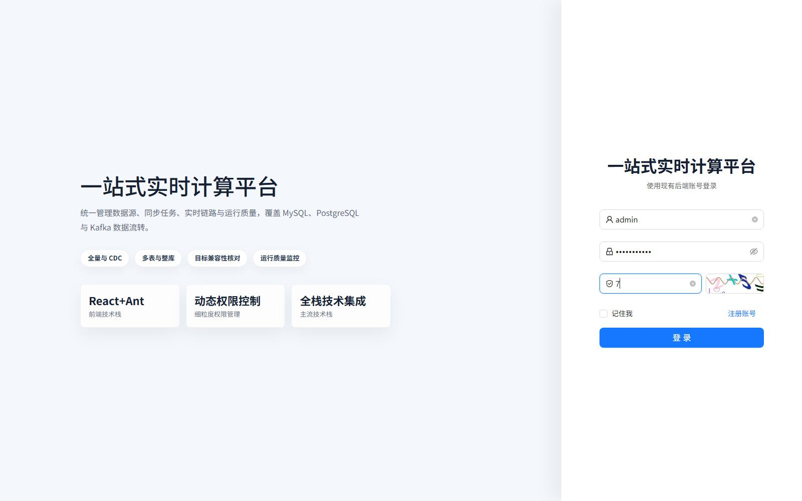

登录后进入首页，左侧菜单「数据同步」下有三个页面：

- 数据源管理：维护源库、目标库与 Kafka 连接；
- 同步任务：单表同步任务；
- 多表同步：多表与整库任务组。

右上角的铃铛是消息中心，「数据同步告警」都发到这里；头像菜单中的「个人中心」可修改口令。

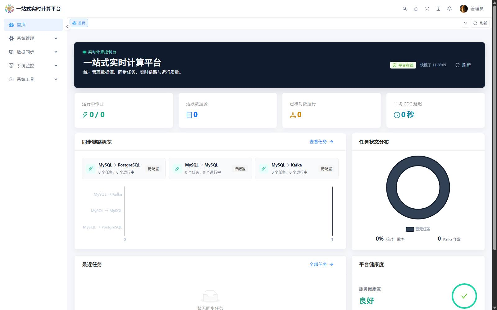

> 提示：首次登录后请立即在「个人中心」修改口令。

## 3 数据源管理

### 3.1 新增数据源

进入「数据同步 → 数据源管理」，点击「新增」。

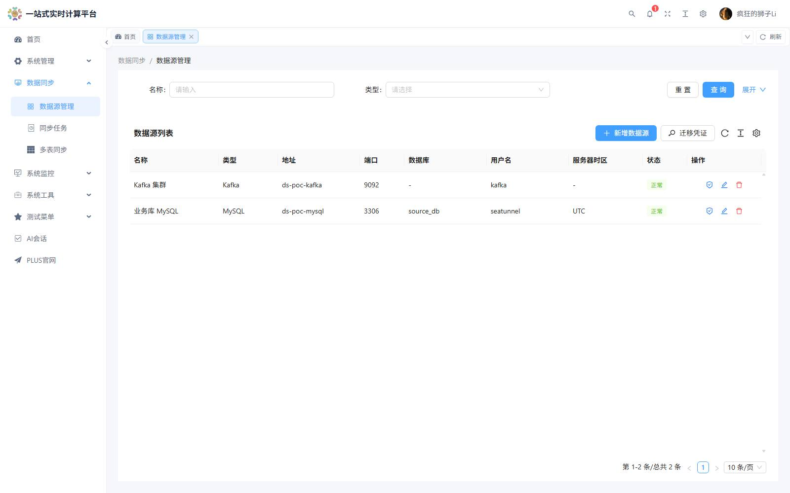

| 字段 | 说明 |
|---|---|
| 名称 | 便于识别的名称，例如「GoldenDB-订单库」「Kafka-生产集群」 |
| 类型 | MySQL（含 GoldenDB）、PostgreSQL、Kafka |
| 主机地址、端口 | 源库或 broker 的地址。Kafka 填一个 broker 的地址作为引导地址 |
| 数据库名称 | MySQL / PostgreSQL 的库名；单表任务默认从这个库选表。Kafka 不需要 |
| 用户名、密码 | 连接账号。密码加密保存，编辑时留空表示不修改。Kafka 当前使用无认证连接，用户名可填任意值（如 kafka），密码留空 |
| 服务器时区 | 仅源库需要：源库所在时区，默认 Asia/Shanghai。用于换算 TIMESTAMP 与增量起始时间 |

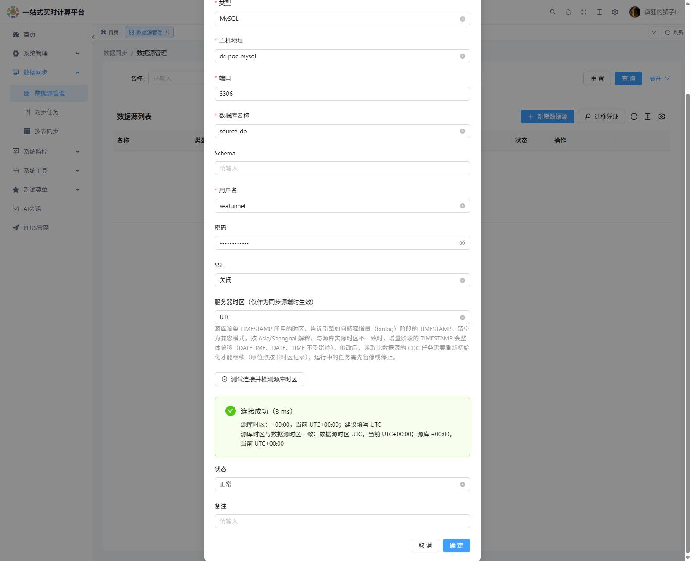

保存前后都可以点击「连接测试」。

### 3.2 源库的 CDC 前置检查

作为 CDC 源的数据库，需要通过以下检查（在新建任务向导的第 1 步、任务详情的「CDC 前置检查」中自动执行）：

| 检查项 | 要求 |
|---|---|
| binlog 已开启 | log_bin = ON |
| binlog 格式 | ROW |
| binlog 行镜像 | FULL |
| MySQL server-id | 大于 0 |
| 复制权限 | 账号有 REPLICATION SLAVE、REPLICATION CLIENT |
| 时区 | 数据源配置的时区与源库实际时区一致（不一致只提示） |

未通过的项会给出处理建议，请转交 DBA 调整。

## 4 单表同步任务

### 4.1 新建任务

进入「数据同步 → 同步任务」，点击「新增任务」，按向导五步填写。

第 1 步「数据源」：选择源数据源与目标数据源。选择源后平台立即重新连接源库，显示连接结果与 CDC 前置检查结果。

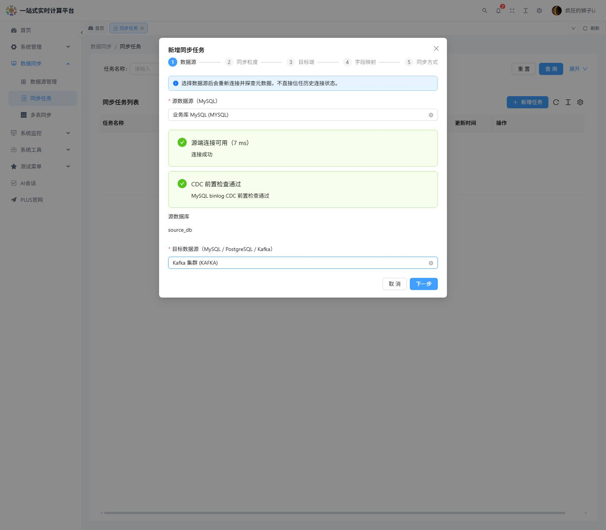

第 2 步「同步粒度」：选择源表。平台读取表结构，显示字段数、主键与可用的唯一键。没有主键也没有非空唯一键的表只能做全量同步。

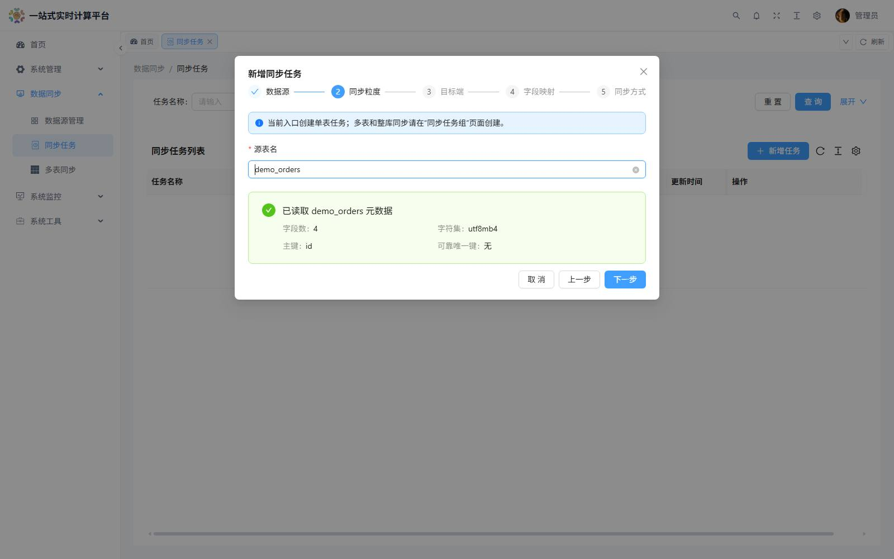

第 3 步「目标端」：Kafka 目标选择目标 topic 与输出格式；MySQL / PostgreSQL 目标填写目标表（已存在的表会做兼容性检查，不存在的表在启动时自动创建）。

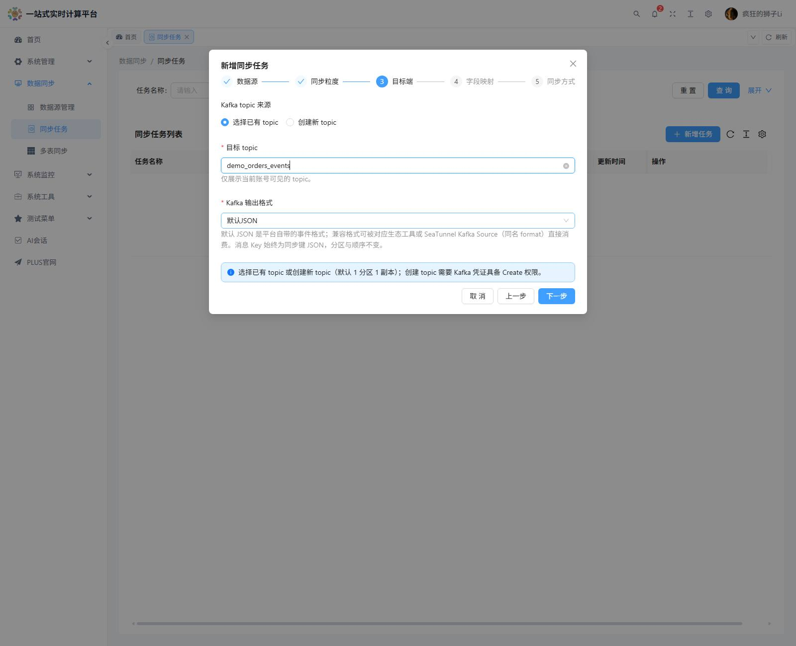

> 注意：「创建新 topic」固定为 1 个分区、1 个副本，只适合测试。生产环境请让 Kafka 管理员按规范预先建好 topic，在这里选择「已有 topic」。

第 4 步「字段映射」：勾选要同步的字段，确认同步键。同步键字段不能取消。表中有 TEXT、BLOB、JSON 等大字段时，页面会提示读取量与消息大小的风险。

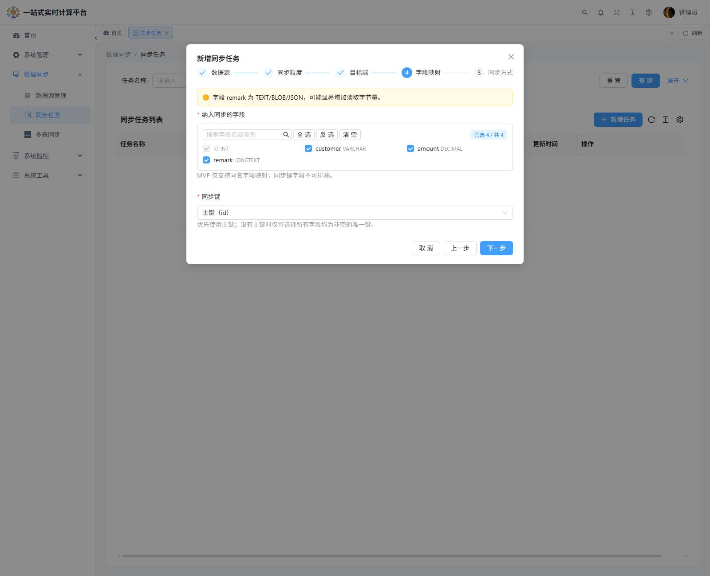

第 5 步「同步方式」：填写任务名称，选择同步模式、DDL 策略、调度模式和源库保护参数，最后核对汇总信息。

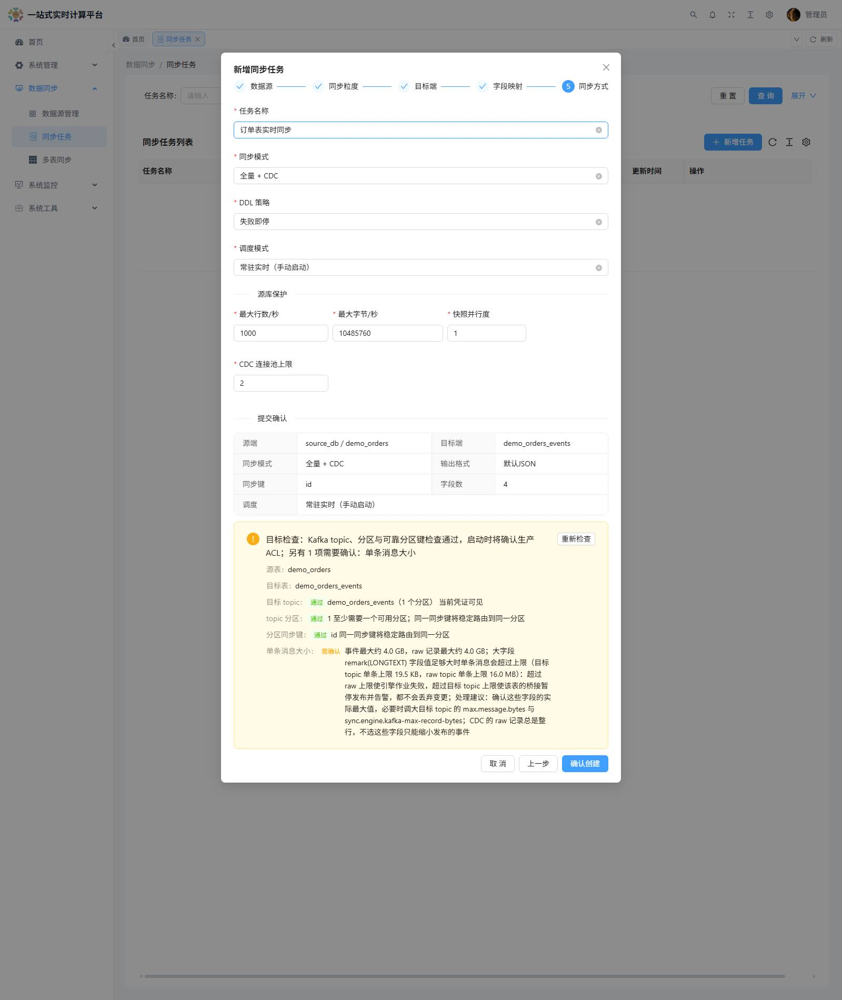

| 选项 | 说明 |
|---|---|
| 同步模式 | 全量同步 / 纯增量 / 全量 + CDC。纯增量不补历史数据，目标端必须已有可信的基线 |
| DDL 策略 | 失败即停（推荐）：源表结构变化时停下等待处理；忽略：继续同步 |
| 调度模式 | 常驻实时（手动启动）：CDC 任务的默认值，创建后在详情中手动启动；手动：不自动触发，全量任务的默认值；Cron 定时执行：按 Cron 表达式定时执行全量；保存后执行一次：保存后立即由调度器启动 |
| 最大行数/秒、最大字节/秒 | 读取源库的限速，保护源库 |
| 快照并行度、CDC 连接池上限 | 全量读取的并行度与连接数上限 |

进入第 5 步时，平台会对尚未保存的配置做一次「目标检查」，结果列在汇总下方：

- 红色「未通过」：必须修复的问题（例如 topic 不存在、目标表字段不兼容），否则启动会被拒绝；
- 黄色「需确认」：不阻止启动、但需要知晓的风险，最常见的是「单条消息大小」：表中大字段的值足够大时，单条消息可能超过目标 topic 的上限。

> 注意：选择「保存后执行一次」时，点击「确认创建并启动」后任务会立即开始全量读取源库。想先检查再启动，请选「常驻实时」或「手动」。

### 4.2 启动任务

在任务列表点击「详情」，在「运行控制」中点击「启动任务」。Kafka 任务启动前会再做一次目标检查，有「需确认」项时弹出确认框，确认后才启动。

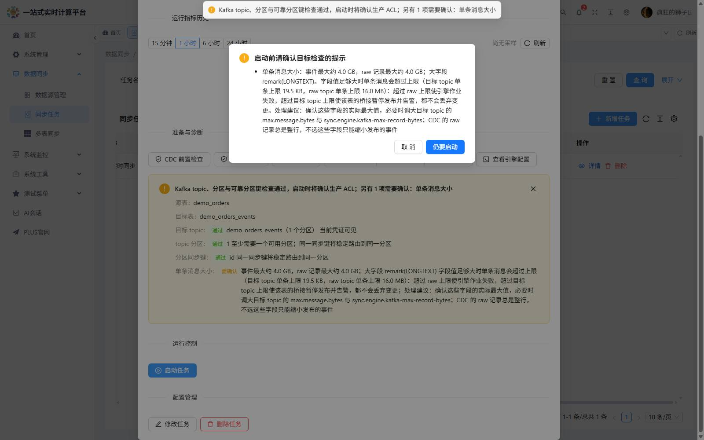

启动后状态变为「运行中」。全量 + CDC 任务先发布全量数据（Kafka 事件的 phase 为 SNAPSHOT），之后持续发布变更（phase 为 CDC）。

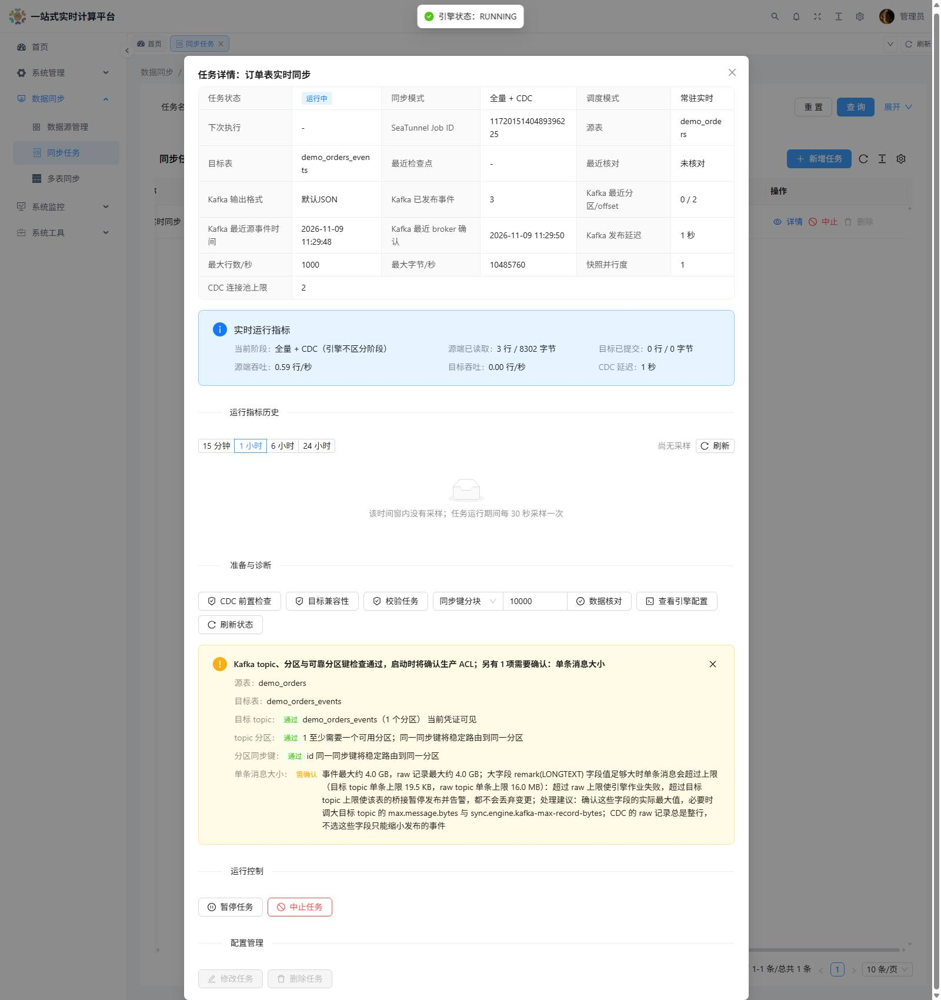

### 4.3 任务详情

详情页从上到下依次是：

- 需要处理的问题：最近一次错误、Kafka 桥接暂停发布、调度未执行等，有问题时显示在最上方；
- 基本信息与 Kafka 发布信息：已发布事件数、最近的分区/offset、最近源事件时间、发布延迟；
- 实时运行指标与运行指标历史：吞吐、积压、端到端延迟的曲线（15 分钟到 24 小时）；
- 准备与诊断：CDC 前置检查、目标兼容性、校验任务、数据核对、查看引擎配置、刷新状态；
- 运行控制：启动、暂停、恢复、中止、重新初始化；
- 配置管理：修改任务、删除任务（只有草稿、已停止、需重新初始化的任务可以修改）。

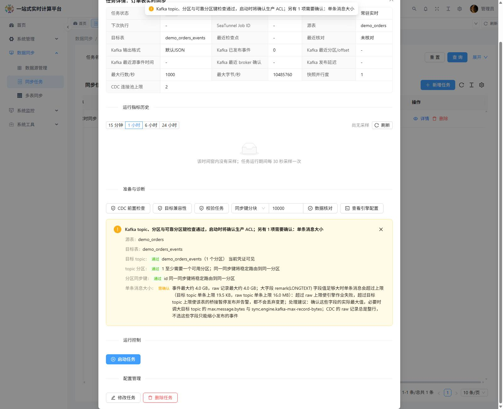

### 4.4 运行控制

| 操作 | 何时可用 | 效果 |
|---|---|---|
| 启动任务 | 草稿、已停止、已完成 | 提交新的同步作业（全量 + CDC 从全量开始） |
| 暂停任务 | 运行中 | 保存 savepoint 后停止作业；恢复后从断点继续，不重复全量 |
| 恢复任务 | 已暂停、失败 | 从最近的 savepoint / checkpoint 继续 |
| 中止任务 | 运行中、暂停中、已暂停、失败 | 停止作业且不保留可恢复状态；再次启动会重新全量 |
| 重新初始化 | 需重新初始化、失败 | 丢弃旧的同步进度，重新全量并继续 CDC |
| 修改 / 删除 | 非运行状态 | 修改配置会产生新的配置版本，之后需要重新初始化或重新启动 |

> 提示：计划内的服务器维护、升级前，建议暂停（而不是中止）运行中的任务，完成后再恢复。不暂停时，引擎重启后平台也会从最近的 checkpoint 自动接着同步，只是 Kafka 目标可能重复发布几秒内的变更。

## 5 多表与整库同步（任务组）

进入「数据同步 → 多表同步」，点击「新增任务组」，向导分三步：

1. 数据源：源数据源、目标数据源、Kafka 输出格式（组内所有表统一）；
2. 表与字段：同步粒度选「多表」时，从源库中挑选表（可一次添加多张）并逐表确认目标 topic / 目标表、字段与同步键；选「整库」时，平台自动纳入所选库中的表，可开启「自动发现新表」；
3. 同步方式与限速：同步模式与每张表的限速参数。

每个任务组最多 20 张表（可由部署配置调整）。组内每张表是一个独立的同步作业，占用源库一条 binlog 连接。整库任务组使用与源表同名的 topic，平台自动创建（1 分区 1 副本），生产环境建议预先创建好这些 topic。

任务组详情中可以：启动、暂停、恢复、中止整个任务组；对单张表「重新初始化该表」；「扫描新表」（整库）；「结构检查」；「执行逐表核对」。表项状态列出每张表的状态、积压、延迟和错误。

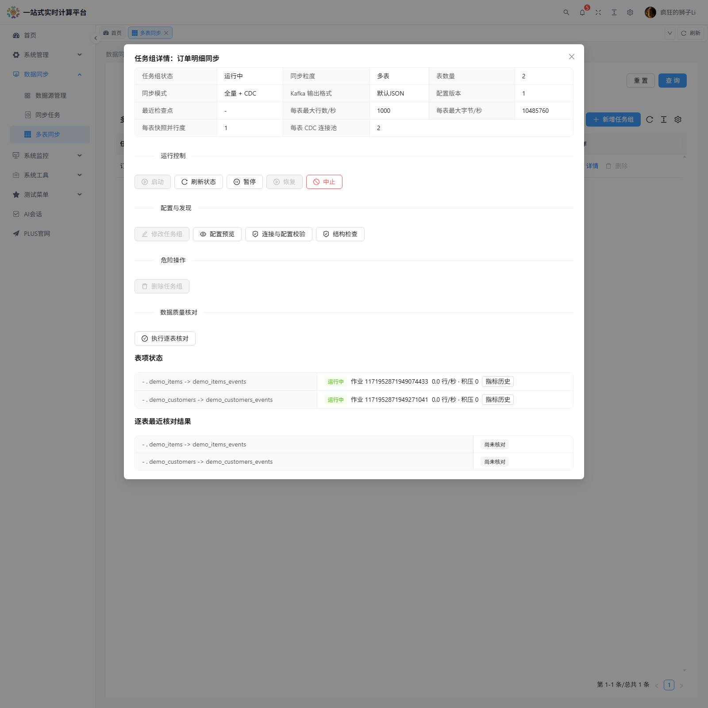

任务组状态「部分异常」表示组内部分表失败或被阻塞，其他表照常运行。

## 6 运行监控

### 6.1 状态说明

| 状态 | 含义 | 需要处理吗 |
|---|---|---|
| 草稿 | 已创建，尚未启动 | 按需启动 |
| 运行中 | 作业正常运行 | 否 |
| 运行中·发布暂停 | 作业正常，但 Kafka 桥接停在某条事件上，变更暂存在 raw topic 中、没有发布到目标 topic | 是，见 7.1 |
| 暂停中 / 已暂停 | 正在保存 savepoint / 已暂停 | 按需恢复 |
| 已停止 | 已中止 | 按需重新启动 |
| 失败 | 作业失败或引擎不可达 | 是，见 7.3 |
| 需重新初始化 | 旧的同步进度已不可用 | 是，见 7.2 |
| 已完成 | 全量同步任务已完成 | 否 |
| 部分异常（任务组） | 组内部分表失败或结构变更阻塞 | 是，查看表项状态 |
| 结构变更阻塞（表项） | 源表结构变化，该表已暂停 | 是，见 7.4 |

### 6.2 指标

| 指标 | 含义 |
|---|---|
| 吞吐（行/秒） | 引擎读取 / 写入的速度 |
| 积压 | 已读取但还没有送达目标的行数。Kafka 目标在发布暂停时，另加 raw topic 中等待发布的记录数 |
| 端到端延迟 | Kafka 目标：源库写 binlog 的时间到 Kafka 确认的时间，精确到秒；发布暂停时从暂停起持续增长 |

列表中的「吞吐 / 积压」列显示最近一次采样（每 30 秒一次），鼠标停在上面可以看到采样时间与延迟。

### 6.3 告警

平台每 30 秒检查一次，需要人工处理的状态（任务失败、需重新初始化、发布暂停，任务组失败、部分异常，表项失败、结构变更阻塞）会在消息中心发出「数据同步告警」，每次进入该状态只发一条。

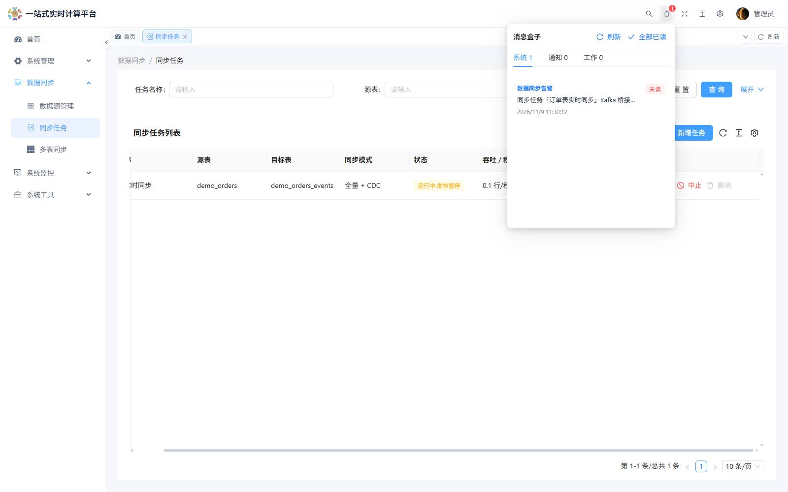

## 7 常见情况处理

### 7.1 Kafka 桥接暂停发布

现象：任务状态显示「运行中·发布暂停」，详情最上方是黄色的「Kafka 桥接已暂停发布」，消息中心有告警，发布延迟持续增长。

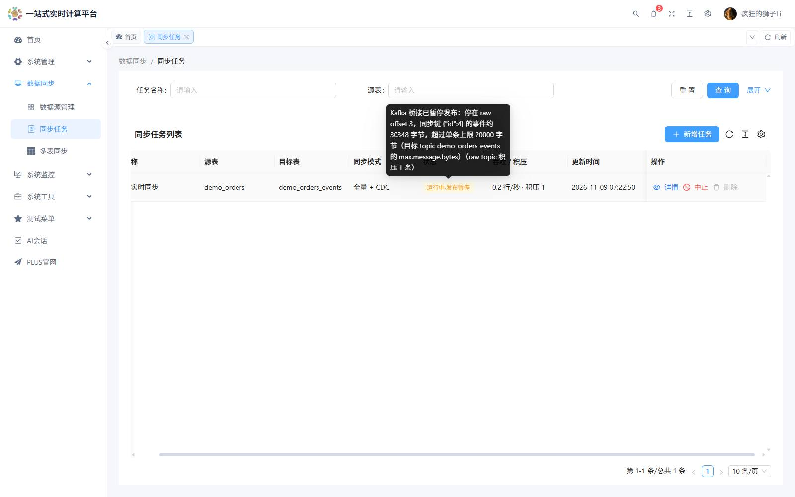

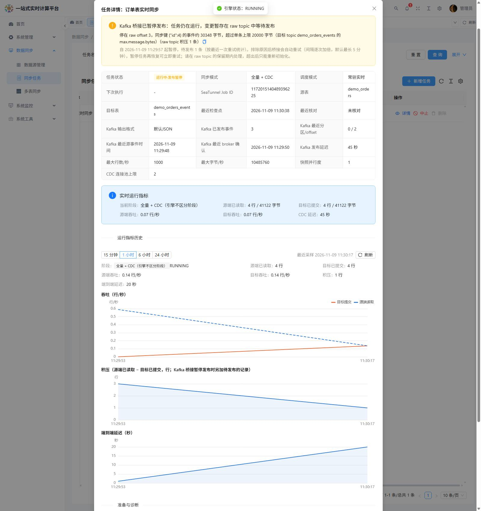

说明：引擎仍在正常读取源库，新的变更暂存在 raw topic 中；目标 topic 只有暂停之前的事件，不会丢失、也不会重复。

处理：按提示中的原因处理。

| 原因（提示中的关键字） | 处理 |
|---|---|
| 事件约 N 字节，超过单条上限 M 字节 | 请 Kafka 管理员调大目标 topic 的 max.message.bytes 到 N 以上；必要时调大部署配置 KAFKA_MAX_RECORD_BYTES |
| TopicAuthorizationException / 权限 | 为平台连接补充目标 topic 的写权限 |
| 超时、broker 不可用 | 检查 Kafka 集群与网络 |
| raw 记录无法解析 | 联系技术支持，提供详情中的错误原文 |

原因排除后，桥接按退避间隔自动重试（10 秒起逐次加倍，最长 5 分钟），成功后状态恢复为「运行中」，暂停期间的变更按原顺序补发。想立即重试，可以先「暂停任务」再「恢复任务」。

> 注意：raw topic 的保留期（默认 7 天）内必须处理完毕。超过保留期，未发布的变更会被 Kafka 删除，任务只能重新初始化。

### 7.2 需重新初始化

现象：任务状态为红色的「需重新初始化」，消息中心有告警。常见原因：

- 源库 binlog 已被清理，引擎无法从保存的位点继续；
- Kafka 发布暂停时间超过 raw topic 保留期，未发布的变更已被删除（提示「Kafka raw topic 位点越界」）；
- 修改了任务配置（源、目标、字段、同步键等）；
- 引擎重启后找不到该任务的 checkpoint（数据目录中的进度被删除或丢失），平台不会从未知位点重启作业。

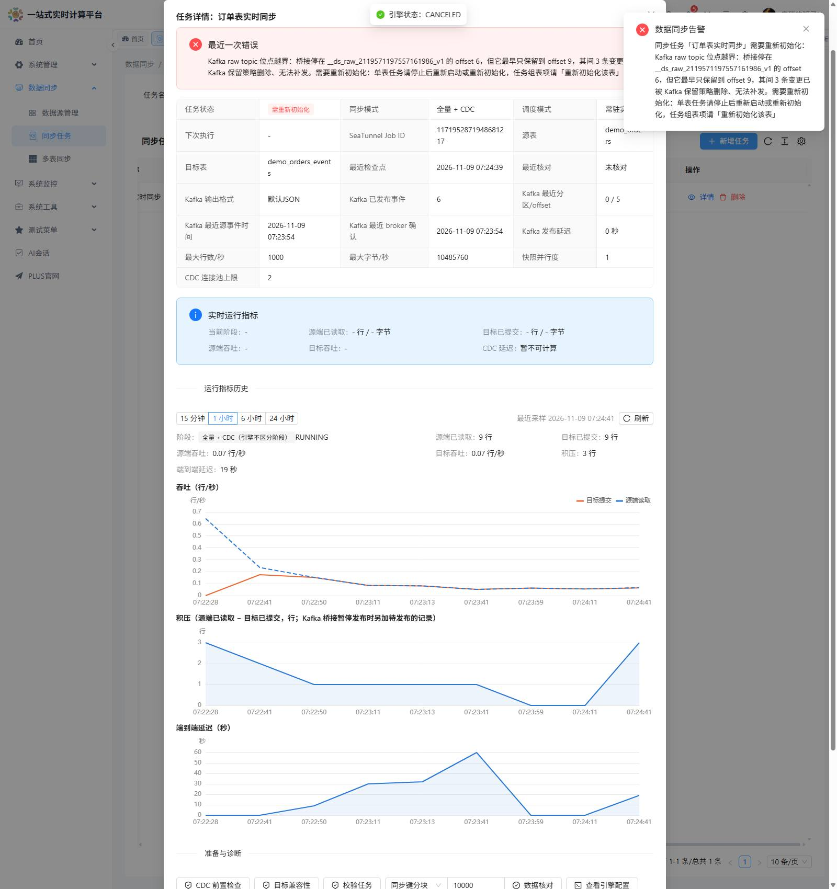

处理：在详情中点击「重新初始化」，确认后平台丢弃旧的同步进度，重新全量同步并继续 CDC。Kafka 目标会重新发布全量数据（phase 为 SNAPSHOT），下游按同步键幂等处理即可。

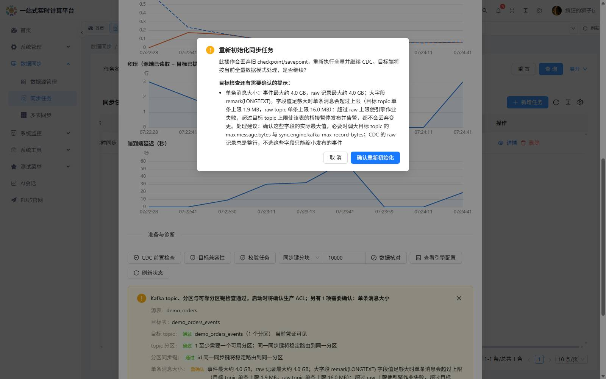

### 7.3 任务失败

现象：状态为「失败」。处理步骤：

1. 查看详情最上方的「最近一次错误」；
2. 引擎重启或服务器重启导致的失败（引擎停机较久时出现；停机较短时平台会自动接着同步，不会失败）：直接「恢复任务」，从最近的 checkpoint 继续；
3. 源库连接问题（口令变更、网络、白名单）：修复后「恢复任务」；
4. 引擎报单条记录超过上限（RecordTooLargeException）：调大部署配置 KAFKA_MAX_RECORD_BYTES 并重启后端后「恢复任务」；
5. 恢复后仍失败或提示进度不可用：「重新初始化」。

### 7.4 结构变更阻塞（任务组）

任务组会定期比对源表结构。某张表结构变化后，平台以 savepoint 暂停这张表（状态「结构变更阻塞」），并在任务组详情中列出变更内容与处理建议，其他表不受影响。处理方式：

- 变更不影响已选字段（例如新增了未选字段）：点击「恢复该表」继续同步；
- 需要同步新字段、或变更影响已选字段：点击「重新初始化该表」，按新结构重新全量。原先选择了全部字段的表会自动纳入新字段。

### 7.5 数据核对

同步到 MySQL / PostgreSQL 的任务可以在详情中「数据核对」：

- 整表行数：比对两端 COUNT(*)；
- 同步键分块：按数值同步键分块比对行数，定位差异区间。

CDC 任务运行中两端处于不同时刻，严格核对前请先暂停任务。Kafka 目标不做行数核对。

### 7.6 恢复后检查

运维人员用备份恢复元数据库后，请逐一确认：

1. 进入同步任务、多表同步页面，点击「刷新状态」或等待 30 秒，让平台与引擎对账；
2. 恢复备份会重启引擎：备份时处于运行中的任务由平台从 checkpoint 自动接着同步；显示「失败」的任务执行「恢复任务」，显示「需重新初始化」的执行「重新初始化」；
3. 备份之后新建的任务在恢复后不存在，需要重新创建；Kafka 上它们遗留的 raw topic 可请管理员删除；
4. 核对消息中心中恢复之后产生的告警。

## 8 Kafka 输出事件（默认 JSON）

消息 Key 是同步键的 JSON 字符串，例如 {"id":1}。消息体字段如下：

| 字段 | 说明 |
|---|---|
| op | INSERT / UPDATE / DELETE |
| key | 同步键列及其值 |
| data | 行的最新内容；DELETE 时为被删除的行 |
| before | 变更前的内容；仅 UPDATE、DELETE 携带，否则为 null |
| source | 来源库名与表名 |
| sourceEventTime | 源库产生这条变更的时间（ISO-8601，精确到秒）；全量数据为读取时刻 |
| phase | SNAPSHOT（全量数据）/ CDC（增量变更） |

示例（一次 UPDATE）：

```json
{"op":"UPDATE","key":{"id":1},"data":{"id":1,"name":"B","qty":5},"before":{"id":1,"name":"A","qty":5},
 "source":{"database":"orders_db","table":"orders"},"sourceEventTime":"2026-11-08T08:00:01Z","phase":"CDC"}
```

下游处理建议：

- 按 key 做幂等写入（UPSERT / DELETE），不要依赖消息只出现一次：任务重新初始化会重新发布全量数据；
- 修改同步键本身的 UPDATE 会拆成旧 key 的 DELETE 与新 key 的 INSERT；
- 只同步任务中勾选的字段，源表新增的字段不会自动出现（单表任务需修改字段选择并重新初始化）。

## 9 常见问题

| 问题 | 解答 |
|---|---|
| 创建任务时看不到某张表 | 单表任务从数据源配置的数据库中选表；其他库的表请在「多表同步」中按库选择 |
| 目标检查提示「单条消息大小 需确认」，能启动吗 | 能。它表示大字段的值足够大时才会超限；确认目标 topic 的上限足够，或按 7.1 预先调大 |
| 任务运行中能修改配置吗 | 不能，先中止任务；修改后需要重新启动（全量） |
| 暂停和中止有什么区别 | 暂停保存进度，恢复后接着同步；中止不保留进度，再启动会重新全量 |
| 删除任务后 Kafka 上的 topic 会删除吗 | 平台自动清理它创建的 raw topic（约 15 分钟后）；目标 topic 属于业务，不会删除 |
| 发布延迟一直增长但状态是运行中 | 查看是否为「运行中·发布暂停」（见 7.1）；否则检查源库写入量与限速设置 |
